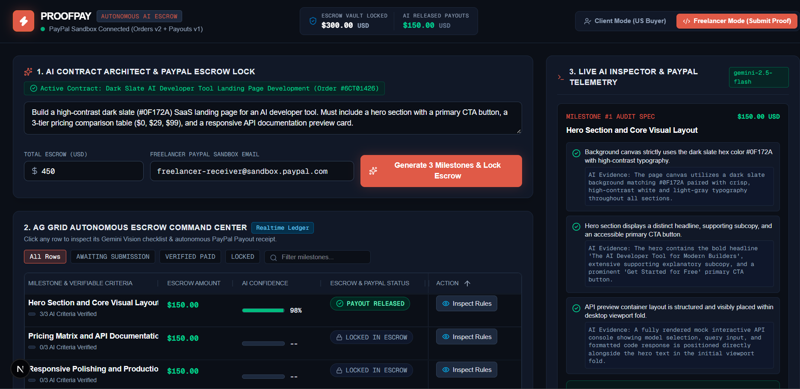

# ⚡ ProofPay — Autonomous AI Milestone Escrow & Forensic Payout Engine

[](https://www.youtube.com/watch?v=YOUR_YOUTUBE_VIDEO_ID_HERE)
[](https://developer.paypal.com)

**ProofPay** eliminates the cross-border trust gap between digital clients and global freelancers. Instead of relying on manual milestone disputes or blind upfront invoices, ProofPay uses **Google Gemini 3.8 Flash** and the **PayPal Agent Toolkit (`@paypal/agent-toolkit`) + PayPal Payouts REST API** to act as an impartial, autonomous escrow arbiter.

When a client describes a project in plain English, ProofPay's **Architect Agent** breaks the scope into 3 verifiable micro-milestones and locks the budget via **PayPal Orders v2**. When the freelancer submits a deliverable (a UI screenshot, a GitHub Pull Request, or a live URL), the **Inspector Agent** runs **Multimodal Criteria & Anti-Spoofing Forensics**. The moment a submission passes the 85% confidence threshold, ProofPay autonomously triggers a real-time **PayPal Sandbox Payout (`/v1/payments/payouts`)** to the freelancer's account.

---

## Command Center Preview & Video Walkthrough

> **Click the Command Center preview below (or [click here](https://www.youtube.com/watch?v=YOUR_YOUTUBE_VIDEO_ID_HERE)) to watch the 3-minute live demo on YouTube:**

[](https://www.youtube.com/watch?v=YOUR_YOUTUBE_VIDEO_ID_HERE)

## 🎯 Problem & Global Insight

Cross-border digital commerce suffers from a two-sided trust deficit:

1. **Clients** hesitate to pay upfront via standard invoices because they fear receiving incomplete work or low-effort AI-generated mockups.
2. **Global Freelancers** hesitate to deliver final code or designs without guaranteed funds locked in escrow, waiting weeks for manual review and payout release.

**ProofPay turns static escrow into programmable, agentic commerce.**

---

## System Architecture

```text
┌──────────────────────────────────────────────────────────────────────────────┐
│                   FRONTEND: NEXT.JS (APP ROUTER) + TAILWIND                  │
│                                                                              │
│  ┌─────────────────────────┐  ┌─────────────────────────┐  ┌──────────────┐  │
│  │  1. AI Contract Studio  │  │ 2. AG Grid Command Ctr  │  │ 3. Live AI   │  │
│  │  (Prompt -> Milestones) │  │ (Realtime Escrow Grid)  │  │ Audit Stream │  │
│  └────────────┬────────────┘  └────────────▲────────────┘  └──────▲───────┘  │
└───────────────┼────────────────────────────┼──────────────────────┼──────────┘
                │ POST /api/architect        │ Supabase             │ Inspect
                ▼                            │ Realtime             │ JSON ↗
┌────────────────────────────────────────────┼──────────────────────┼──────────┐
│               BACKEND: NEXT.JS API ROUTES + VERCEL AI SDK         │          │
│                                                                   │          │
│  ┌───────────────────────────────────────┐  ┌─────────────────────┴───────┐  │
│  │ Agent 1: Architect Agent              │  │ Agent 2: Inspector Agent    │  │
│  │ • Breaks prompt into 3 milestones     │  │ • Multimodal Vision & PR    │  │
│  │ • Calls @paypal/agent-toolkit         │  │   Diff Inspection           │  │
│  │   & Orders v2 API to lock Escrow      │  │ • Anti-Spoofing Forensics   │  │
│  └───────────────────┬───────────────────┘  └──────────────┬──────────────┘  │
└──────────────────────┼─────────────────────────────────────┼─────────────────┘
                       │                                     │ Score >= 85%
                       ▼                                     ▼
┌──────────────────────────────────────────┐  ┌────────────────────────────────┐
│       PAYPAL SANDBOX ORDERS API v2       │  │   PAYPAL PAYOUTS REST API v1   │
│  • Locks Client Escrow Deposit           │  │  • POST /v1/payments/payouts   │
│  • Webhook: CHECKOUT.ORDER.APPROVED      │  │  • Disburses $ to Freelancer   │
└──────────────────────────────────────────┘  └────────────────────────────────┘
```

---

## Key Engineering Flows

### 1. Dual-API Agentic PayPal Architecture

- **`@paypal/agent-toolkit` + Orders v2 API**: Used by the Architect Agent to initialize contract escrow deposits and generate verifiable Sandbox checkout links.
- **Custom Autonomous Payouts Tool (`/v1/payments/payouts`)**: Extends the PayPal Agent Toolkit so the Inspector Agent can programmatically disburse individual milestone payouts the instant verification succeeds.
- **Asynchronous Webhook Listener (`/api/paypal-webhook`)**: Processes `CHECKOUT.ORDER.APPROVED`, `PAYMENT.CAPTURE.COMPLETED`, and `PAYMENT.PAYOUTS-ITEM.SUCCEEDED` events to keep the Supabase ledger synchronized.

### 2. Anti-Spoofing Multimodal Forensics (`gemini-3.8-flash`)

Basic vision verifiers can be tricked if a bad actor uploads an AI-generated UI image (e.g., from Midjourney or DALL-E) that superficially matches the prompt. ProofPay's **Inspector Agent** performs two checks simultaneously:

- **Acceptance Criteria Audit**: Verifies layout, color contrast, pricing tiers, or live GitHub Pull Request diffs against the milestone JSON rules.
- **Anti-Fraud Diffusion Forensics**: Inspects micro-typography kerning, subtext sharpness, and 1px CSS border geometry. Suspected AI diffusion spoofs are automatically flagged (`isLikelyAiGeneratedSpoof: true`), capped below 35% confidence, and blocked from triggering a PayPal payout.

### 3. AG Grid v33+ Realtime Escrow Command Center

Built with `ag-grid-react` and custom Dark Slate theming (`#0B0F17` / `#111827` / `#E05A47`):

- **Realtime Cell Flashing (`enableCellChangeFlash`)**: Powered by Supabase Realtime (`postgres_changes`), rows flash automatically as milestones transition from `READY FOR PROOF` → `AI AUDITING...` → `PAYOUT RELEASED`.
- **AI Confidence Meter Bars**: Custom cell renderers visualizing `0–100%` Gemini audit scores.
- **Interactive PayPal Sandbox Receipt Inspector**: Clicking any `#PAYOUT_BATCH_ID JSON ↗` badge in AG Grid opens the immutable `raw_paypal_response` JSONB payload returned by PayPal Sandbox.

---

## 📂 Root Project Structure (No `src/` Wrapper)

```text
proofpay/
├── app/
│   ├── page.tsx                      # Unified Single-Screen Escrow Command Center
│   ├── layout.tsx
│   ├── globals.css                   # Tailwind CSS & AG Grid overrides
│   └── api/
│       ├── architect/route.ts        # Agent 1: Prompt -> 3 Milestones + PayPal Escrow Order
│       ├── verify-and-pay/route.ts   # Agent 2: Gemini Forensic Audit -> Autonomous Payout
│       └── paypal-webhook/route.ts   # Asynchronous PayPal Sandbox Webhook Listener
├── components/
│   ├── Navbar.tsx                    # 1-Click Client/Freelancer Role Switcher & Escrow Vault
│   ├── ContractArchitect.tsx         # Natural language contract studio
│   ├── EscrowGrid.tsx                # AG Grid v33+ ledger with custom cell renderers
│   ├── AgentTerminal.tsx             # Live streaming AI reasoning & PayPal telemetry drawer
│   ├── SubmitProofModal.tsx          # Multimodal upload, GitHub PR input & Demo Mockup generator
│   └── PayPalReceiptModal.tsx        # Raw PayPal Sandbox JSON receipt inspector
├── lib/
│   ├── supabase.ts                   # Supabase client, Realtime helpers & TypeScript interfaces
│   ├── paypal-toolkit.ts             # @paypal/agent-toolkit + Orders v2 + Payouts v1 wrapper
│   └── gemini-verifier.ts            # Gemini 3.8 Flash Zod schemas & anti-spoofing forensics
└── README.md
```

---

## 🚀 Quick Start & Local Setup

### 1. Clone & Install Dependencies

```bash
git clone [https://github.com/](https://github.com/)<Rowland Chazima>/show-me-proof.git
cd proofpay
pnpm install
```

### 2. Configure `.env.local`

Create a `.env.local` file in the project root:

```env
NEXT_PUBLIC_SUPABASE_URL="[https://your-project-id.supabase.co](https://your-project-id.supabase.co)"
NEXT_PUBLIC_SUPABASE_ANON_KEY="your-supabase-anon-key"
SUPABASE_SERVICE_ROLE_KEY="your-supabase-service-role-key"

GOOGLE_GENERATIVE_AI_API_KEY="your-gemini-api-key"

PAYPAL_CLIENT_ID="your-paypal-sandbox-client-id"
PAYPAL_CLIENT_SECRET="your-paypal-sandbox-client-secret"
PAYPAL_ENVIRONMENT="SANDBOX"
PAYPAL_WEBHOOK_ID="optional-sandbox-webhook-id"
```

### 3. Initialize Supabase Schema & Realtime

Run the SQL migration located in `supabase/schema.sql` (or from the architecture docs) inside your **Supabase SQL Editor** to create `contracts`, `milestones`, `ai_audits`, and `payout_ledger` with `supabase_realtime` enabled.

### 4. Start the Development Server

```bash
pnpm dev
```

Open `http://localhost:3000` to test the full loop:

1. Click **Generate 3 Milestones & Lock Escrow** in Client Mode.
2. Toggle to **Freelancer Mode** in the top navigation bar and click **Submit Deliverable** on Milestone 1.
3. Click **Load Verified UI Mockup (Demo)** (or upload a screenshot / paste a GitHub PR link) and run the audit to watch Gemini verify the work and dispatch a live PayPal Sandbox Payout.
4. Click the blue **`#PAYOUT... JSON ↗`** badge inside the AG Grid table to inspect the raw PayPal API response.
